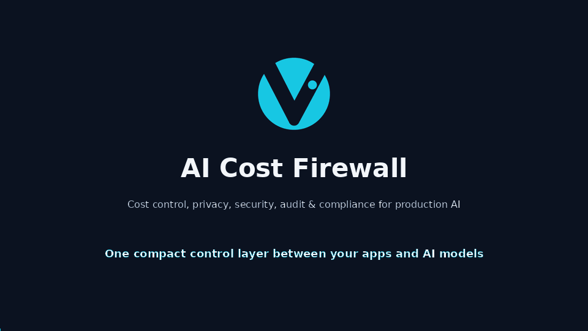
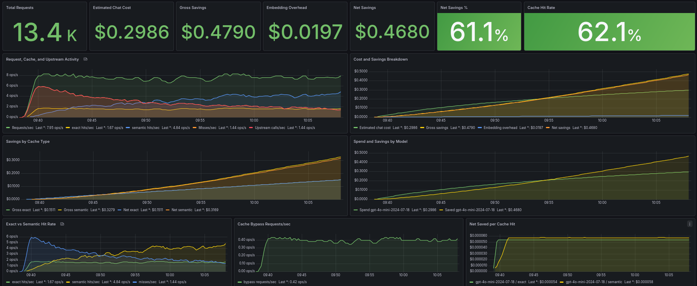

# AI Cost Firewall


**Self-hosted, OpenAI-compatible gateway for LLM cost optimization, observability, and optional policy controls.**

AI Cost Firewall (AIF) sits between AI applications and OpenAI-compatible model endpoints. It reduces repeated upstream calls through **exact caching (Redis)** and **semantic caching (Qdrant)**, tracks costs, and supports non-disruptive evaluation before enabling cache reuse.

AIF runs independently as an open-source gateway. Optional **commercial VCAL modules** add privacy, security, organizational usage controls, auditing, and compliance capabilities.

<p align="center">
  
</p>

Developed and maintained by **VCAL Labs, Inc.** · [Documentation portal](https://ai-firewall.docs.vcal-project.com/) · [Releases](https://github.com/vcal-project/ai-firewall/releases)

## Quick Start

On Linux with Docker Engine and the Docker Compose plugin already installed:

```bash
curl -fsSL https://vcal-project.com/install-aif.sh | bash
```

The installer starts **AIF, Redis, Qdrant, Prometheus, and Grafana** and provisions monitoring dashboards. It has been tested on Ubuntu and Rocky Linux 9/10 (x86_64).

1. Set a valid OpenAI-compatible upstream URL and authentication (if required) in `~/ai-firewall/configs/ai-firewall.conf`. Configure a compatible embedding endpoint/model for semantic-cache evaluation.
2. Restart AIF:

   ```bash
   cd ~/ai-firewall && docker compose restart firewall
   ```
3. Open Grafana at `http://127.0.0.1:3000` **on the installation host** (or connect through an SSH tunnel). The generated admin password is stored in `~/ai-firewall/.env`.

**The one-line installer starts in Observe Mode.** Requests still reach the upstream model, while AIF measures potential cache and cost savings. Healthy containers do not by themselves prove provider connectivity.

Read the [installer prerequisites and troubleshooting](deploy/quickstart/README.md), or follow the [manual Docker Compose guide](docs/quickstart.md). Review a remote installation script before running it.

## Why AI Cost Firewall?

Repeated and semantically similar LLM requests can waste tokens and incur avoidable provider latency. In **Enforce Mode**, AIF can serve eligible responses from cache instead of calling the upstream model.

```text
Application → AI Cost Firewall → Redis exact cache → Qdrant semantic cache
                           └── on miss/bypass → OpenAI-compatible LLM
```

In **Observe Mode**, AIF uses isolated shadow caches to estimate opportunities without substituting cached answers for the live upstream response.

[How AIF works](docs/how-it-works.md) · [Architecture](docs/architecture.md)

## Key Capabilities

- **Two-layer caching:** Redis exact cache and Qdrant semantic cache with configurable cache controls.
- **OpenAI-compatible APIs:** chat completions, `GET /v1/models` proxying, and controlled SSE delivery for streaming chat completions.
- **Observe / Enforce:** measure hypothetical savings using isolated evaluation state, or serve eligible cache hits in normal operation.
- **Cost and operational visibility:** Prometheus metrics, Grafana dashboards, per-model cost estimates, cache diagnostics, and evidence events.
- **Operational controls:** configuration validation, readiness/startup/liveness probes, fail-open settings, request limits, and graceful shutdown.
- **Deployment flexibility:** Docker Compose examples and an OpenShift `restricted-v2` deployment baseline.

**Controlled streaming is buffered:** AIF assembles and checks the full provider response before replaying it as SSE. It does **not** forward model tokens immediately as they arrive. [Details](docs/controlled-streaming.md).

## Observe vs. Enforce

| Mode | Cache decision | Client response | Savings figures |
|---|---|---|---|
| `observe` | Isolated shadow exact/semantic caches | Live upstream response | **Estimated** opportunities; separate evaluation metrics |
| `enforce` | Production exact/semantic caches | Eligible cache hit, otherwise upstream | **Realized** cache savings estimates |

```conf
# Installer default: observe; normal runtime default: enforce.
aif_enforcement_mode observe;
```

Observe Mode applies to **AIF cache optimization**, not to the enforcement settings of independently configured VCAL Guards. For assessment reproducibility, AIF provides the sanitized `GET /assessment-context` endpoint and a configuration identity metric.

[Evaluation Mode](docs/evaluation-mode.md) · [Assessment Context](docs/assessment-context.md) · [Evaluation validation](EVALUATION_VALIDATION.md)

## Optional VCAL Integrations

AIF can orchestrate separately licensed modules. **None is required for the open-source AIF gateway.**

| Module | Role |
|---|---|
| VCAL Security Guard | Request/response security inspection and enforcement |
| VCAL Privacy Guard | Sensitive-data detection, anonymization/redaction, and optional restoration |
| VCAL Usage Guard | Organizational AI usage-policy decisions |
| VCAL Audit | Structured evidence ingestion and trace reconstruction |
| VCAL Compliance | Compliance/reporting workflows using Audit data |

Guards can be enabled individually or together. Content inspection coverage depends on the particular module and its adapter; do not assume that all Guards inspect every structured content shape. [Guard operation](docs/operation.md) · [Audit integration](docs/audit-integration.md).

## API and Provider Compatibility

AIF expects **OpenAI-compatible** chat and embedding endpoints. Common patterns include OpenAI, Ollama, LM Studio, vLLM, LiteLLM, and OpenRouter. The chat and embedding endpoints can be configured separately.

Current gateway routes include `POST /v1/chat/completions` and `GET /v1/models` (discovery through the configured chat upstream). Provider SSE support is needed for `stream=true`, not for normal JSON responses.

**Limitations:** AIF is not a universal provider adapter. Native Anthropic, Gemini, Mistral, and Cohere APIs are not directly supported; use an appropriate OpenAI-compatible compatibility layer. Structured message arrays have specific cache and guard-inspection limits. AIF does **not** fetch or inspect referenced documents, file attachments, or opaque non-text parts.

[Provider Compatibility](docs/provider-compatibility.md) · [Structured Content and Privacy-aware Caching](docs/structured-content.md)

## Dashboards and Evidence

The Docker deployment includes Grafana dashboards for cost, cache effectiveness, and runtime diagnostics. Observe-mode metrics are **not** counted as actual production cache savings.

[](assets/grafana/ai-firewall-overview-021.png)

*Historical demo screenshot from a controlled local workload with simulated upstream; not a production performance guarantee.*

AIF also emits structured evidence (`schema_version: 1.1`), with optional asynchronous delivery to VCAL Audit. Evidence metadata does not include prompt or response content.

[Metrics and Dashboards](docs/metrics-and-costs.md) · [Audit Integration](docs/audit-integration.md)

## Deployment and Configuration

| Start here | Description |
|---|---|
| [One-line installer](deploy/quickstart/README.md) | Five-container stack with monitoring |
| [Manual installation](docs/quickstart.md) | Docker Compose and source-based setup |
| [Deployment examples](deploy/examples/) | Cloud, local Ollama, hybrid, and OpenRouter configurations |
| [OpenShift baseline](deploy/openshift/) | Security-restricted OpenShift manifests |
| [Configuration Reference](docs/config-reference.md) | Nginx-style directives and examples |
| [Operations](docs/operation.md) | Probes, reload, fail-open behavior, and runtime controls |
| [Troubleshooting](docs/troubleshooting.md) | Provider and cache diagnostics |

Validate a repository-based deployment with:

```bash
curl http://localhost:8080/healthz
curl http://localhost:8080/readyz
curl http://localhost:8080/version
```

For provider connectivity, also test the configured upstream or its model-discovery endpoint; health checks alone are not sufficient.

## Benchmarks and Validation

Historical controlled tests with a **local simulated upstream** demonstrated cache effectiveness and gateway throughput. Results depend on test environment and workload; they are **not production capacity guarantees**.

[Benchmark report](BENCHMARKS.md) · [Observe/Enforce validation](EVALUATION_VALIDATION.md)

## Further Documentation

| Topic | Guide |
|---|---|
| Architecture and request flow | [Architecture](docs/architecture.md) · [How It Works](docs/how-it-works.md) |
| Observe Mode and assessments | [Evaluation Mode](docs/evaluation-mode.md) · [Assessment Context](docs/assessment-context.md) |
| Streaming and content | [Controlled Streaming](docs/controlled-streaming.md) · [Structured Content](docs/structured-content.md) |
| Monitoring | [Metrics and Costs](docs/metrics-and-costs.md) |
| Audit and evidence | [Audit Integration](docs/audit-integration.md) |
| Questions and examples | [FAQ](docs/faq.md) · [Examples](deploy/examples/) |

Browse the [full documentation portal](https://ai-firewall.docs.vcal-project.com/) for additional product guidance.

## Build, Test, and Contribute

```bash
git clone https://github.com/vcal-project/ai-firewall.git
cd ai-firewall
cargo build --release
cargo test
```

Contributions in documentation, provider compatibility, deployments, observability, testing, and performance are welcome. See [CONTRIBUTING.md](CONTRIBUTING.md).

## Releases and License

See [GitHub Releases](https://github.com/vcal-project/ai-firewall/releases) for version-specific features, fixes, and compatibility notes.

Licensed under the **Apache License 2.0**. See [LICENSE](LICENSE).
