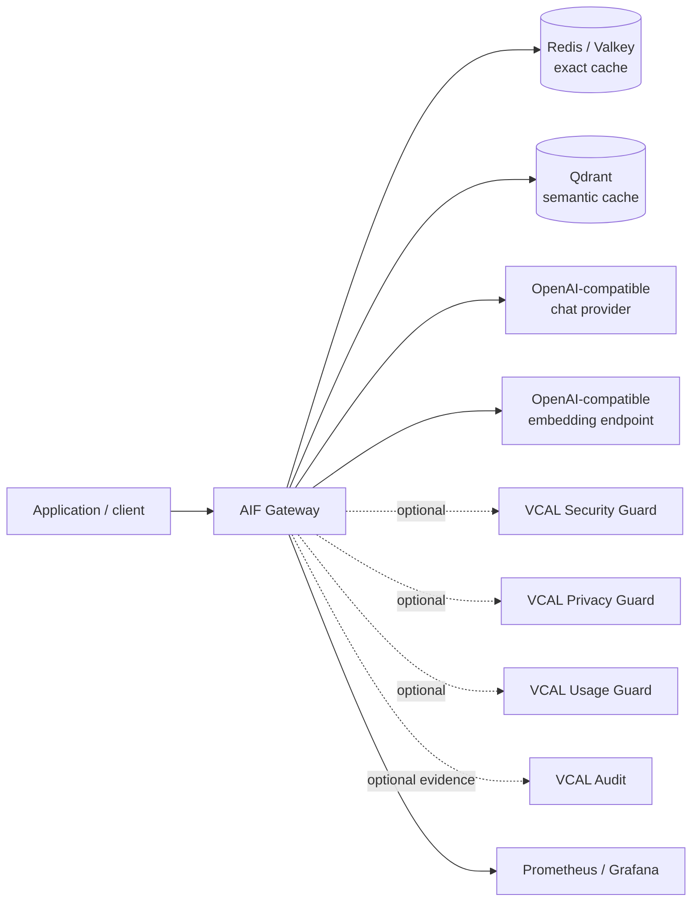

# AI Cost Firewall Architecture

AI Cost Firewall (AIF) sits between AI applications and OpenAI-compatible chat providers. It can return
eligible cached completions in **Enforce Mode**, or measure potential reuse while still calling upstream in
**Observe Mode**. AIF Core does not require any commercial VCAL modules.

## System boundary

The gateway uses HTTP APIs to communicate with chat and embedding providers, Redis/Valkey for exact entries,
and Qdrant for vector-based candidates. The chat and embedding endpoints may be separate services.
Provider-specific native APIs are not directly implemented: see [Provider
Compatibility](provider-compatibility.md).

### Responsibilities

| Component | Main responsibility |
|---|---|
| AIF Gateway | request validation; guard orchestration; routing; cache eligibility and lookup; accounting; metrics and evidence |
| Redis/Valkey | exact request/response cache; independent Observe shadow namespace |
| Qdrant | semantic candidate store; independent Observe shadow collection |
| Embedding service | vector representations for semantic lookup/store |
| Chat provider | live model completion on misses, bypasses, and every Observe request |
| Optional VCAL Guards | independently licensed request/response policy functions |
| Optional VCAL Audit | authenticated external evidence ingestion (not a required request dependency) |
| Prometheus/Grafana | runtime metrics, diagnostics, cost visibility, evaluation history |

## Request-path control points

The simplified order for enabled integrations is:

1. Validate and normalize the incoming OpenAI-compatible request; apply size limits.
2. Optionally scan the original request with **Security Guard**, then anonymize/redact supported text with **Privacy Guard**, then evaluate permitted usage with **Usage Guard**.
3. Apply per-request cache bypass and eligibility rules; check exact cache and, if eligible, semantic cache.
4. In **Enforce Mode**, serve an eligible hit; otherwise call the chat provider. In **Observe Mode**, record the shadow decision but always call the chat provider.
5. For `stream=true`, assemble upstream SSE internally into a complete response before downstream delivery.
6. Run enabled response Security scanning, store eligible pre-restoration responses, restore Privacy placeholders using the current request's mapping, and emit accounting/evidence.
7. Return approved JSON or replay approved OpenAI-compatible SSE. Queue optional Audit evidence separately.

This is deliberately a high-level control map, not a complete state machine. The authoritative detailed
cache algorithm is in [How It Works](how-it-works.md); streaming ordering and error behavior are in
[Controlled Streaming](controlled-streaming.md).

## Cache boundaries and identity

- **Exact cache** uses a transport-independent request identity, including relevant OpenAI-compatible
  extension fields (tools, message metadata, response format, and other preserved parameters). Streaming
  transport flags do not force separate cache entries.
- **Semantic cache** uses embeddings and similarity thresholds, subject to candidate eligibility, cache age,
  and configured model/scope checks. Non-string message content is not eligible for semantic caching.
- **Privacy-aware caching** adds the effective tenant and Privacy Guard policy identity to the cache scope
  when that integration is active. Cached answers are stored **before** placeholder restoration; missing
  effective policy identity or a fail-open Privacy Guard transport error causes cache bypass.
- **Explicit bypass** skips both lookups and stores. A cache hit must not be assumed to be valid for
  arbitrary different user contexts: callers must design cache scope, guard configuration, and request
  identity appropriate to the application.

See [Structured Content](structured-content.md) for inspection boundaries and [Configuration
Reference](config-reference.md) for cache directives.

## Enforce versus Observe

| Property | Enforce | Observe |
|---|---|---|
| Cache hit returned to application | Yes, if eligible | No |
| Live upstream call on would-have hit | Avoided | Always performed |
| Redis/Qdrant cache state | Production | Isolated shadow namespace/collection |
| Savings measurement | Realized cost avoidance estimate | Hypothetical potential avoidance estimate |
| Failure of evaluation-only dependencies | N/A | Non-disruptive to live inference |

Observe Mode applies to **AIF caching/optimization only**; it does not implicitly put Security, Privacy, or
Usage Guard into a shadow mode. See [Evaluation Mode](evaluation-mode.md).

For time-bounded assessments, `GET /assessment-context` supplies a sanitized effective configuration and
`aif_runtime_info` supplies historical configuration identity. Assessment reporting is separate from AIF's
request path. See [Assessment Context](assessment-context.md).

## Security, trust, and data limitations

- The upstream API key authenticates **AIF to the provider**, not the application's incoming connection to
  AIF. Protect gateway ingress with a trusted network, reverse proxy, API gateway, or service mesh as
  appropriate.
- Optional VCAL modules have their own availability and failure policies; `guard_fail_open` governs
  operational failures, not unsupported recognized Privacy text shapes.
- JSON content-part arrays are not synonymous with file scanning. AIF does **not** fetch or inspect
  referenced documents, images, or opaque attachments. See [Structured Content](structured-content.md).
- Controlled SSE prioritizes complete-response approval over immediate token-by-token streaming. See
  [Controlled Streaming](controlled-streaming.md).
- Evidence contains operational metadata, not prompts/responses; delivery to external Audit is bounded,
  buffered, and best effort. See [Evidence and Audit](audit-integration.md).
- The standalone VCAL Semantic Cache Server is **not** currently an AIF cache backend; AIF's semantic
  backend is Qdrant.

## Deployment and observability

The repository provides [Docker Compose examples](../deploy/examples/) and an [OpenShift
baseline](../deploy/openshift/). The AIF image remains a generic non-root OCI workload. Production
deployments should consider network boundaries, credentials, dependency sizing, request concurrency,
readiness/startup probes, and storage lifetimes.

Prometheus exposes cache, upstream, evaluation, guard, streaming, and lifecycle metrics. See [Metrics and
Costs](metrics-and-costs.md), [Operations](operation.md), and [Deployment](deployment.md).

## Further reading

- [How It Works](how-it-works.md) — precise request and caching behavior.
- [Provider Compatibility](provider-compatibility.md) — supported endpoints and limitations.
- [Configuration Reference](config-reference.md) — complete directive documentation.
- [Troubleshooting](troubleshooting.md) — failure symptoms and checks.
