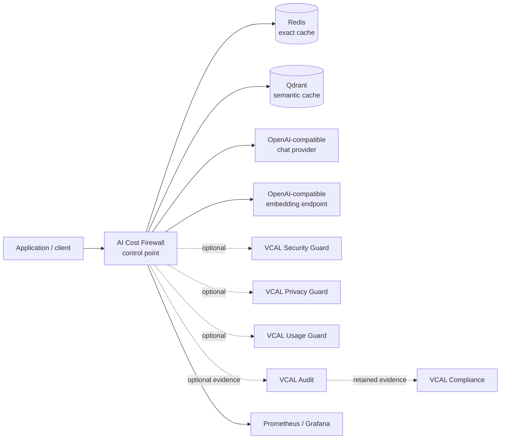

# AI Cost Firewall Architecture

AI Cost Firewall (AIF) is a **self-hosted, OpenAI-compatible control point for production AI**. It runs
inside infrastructure you control, between AI applications and model endpoints. Start in **Observe mode**
to measure potential cache savings without serving cached responses, then switch to **Enforce mode** to
serve eligible cache hits when the evidence supports it. The open-source AIF core has **no software
license fee**; optional VCAL modules are separately licensed.

## System boundary

AIF uses HTTP APIs for chat and embedding providers, Redis for exact entries, and Qdrant for vector-based
candidates. The chat and embedding endpoints may be separate services.
Provider-specific native APIs are not directly implemented: see [Provider
Compatibility](provider-compatibility.md).

### Responsibilities

| Component | Main responsibility |
|---|---|
| AI Cost Firewall | request validation; optional guard orchestration; routing; caching; accounting; metrics and structured evidence |
| Redis | exact request/response cache; isolated Observe-mode evaluation namespace |
| Qdrant | semantic candidate store; isolated Observe-mode evaluation collection |
| Embedding service | vector representations for semantic lookup/store |
| Chat provider | live completions on misses, bypasses, and allowed Observe-mode requests |
| Optional VCAL Guards | independently licensed privacy, security, and organizational usage-policy controls |
| Optional VCAL Audit | authenticated evidence ingestion and trace reconstruction; no required synchronous dependency |
| Optional VCAL Compliance | governance workflows using retained Audit evidence; outside the AIF request path |
| Prometheus / Grafana | runtime metrics, diagnostics, estimated costs, and evaluation history |

## Request-path control points

The simplified order for enabled integrations is:

1. Validate and normalize the incoming OpenAI-compatible request; apply size limits.
2. Optionally scan the original request with **Security Guard**, then anonymize/redact supported text with **Privacy Guard**, then evaluate permitted usage with **Usage Guard**.
3. Apply per-request cache bypass and eligibility rules; check exact cache and, if eligible, semantic cache.
4. In **Enforce mode**, serve an eligible cache hit; otherwise call the chat provider. In **Observe mode**, record the potential cache decision in isolated evaluation state and forward the allowed request upstream.
5. For `stream=true`, assemble upstream SSE internally into a complete response before downstream delivery.
6. Run enabled response Security scanning, store eligible pre-restoration responses, restore Privacy placeholders using the current request's mapping, and emit accounting/evidence.
7. Return approved JSON or replay approved OpenAI-compatible SSE. Queue optional VCAL Audit evidence asynchronously, outside the response path.

This is deliberately a high-level control map, not a complete state machine. The authoritative detailed
cache algorithm is in [How It Works](how-it-works.md); streaming ordering and error behavior are in
[Controlled Streaming](controlled-streaming.md).

## Cache boundaries and identity

- **Exact cache** uses a transport-independent request identity, including relevant OpenAI-compatible
  extension fields (tools, message metadata, response format, and other preserved parameters). Streaming
  transport flags do not force separate cache entries.
- **Semantic cache** uses embeddings and similarity thresholds, subject to candidate eligibility, cache age,
  and configured model/scope checks. Non-string message content is not eligible for semantic caching.
- **Privacy-aware caching** adds the effective tenant and Privacy Guard policy identity to the cache scope
  when that integration is active. Cached answers are stored **before** placeholder restoration; missing
  effective policy identity or a fail-open Privacy Guard transport error causes cache bypass.
- **Explicit bypass** skips both lookups and stores. A cache hit must not be assumed to be valid for
  arbitrary different user contexts: callers must design cache scope, guard configuration, and request
  identity appropriate to the application.

See [Structured Content](structured-content.md) for inspection boundaries and [Configuration
Reference](config-reference.md) for cache directives.

## Observe mode vs. Enforce mode

| Property | Observe mode (`observe`) | Enforce mode (`enforce`) |
|---|---|---|
| Cache hit returned to application | No | Yes, if eligible |
| Upstream call on a potential hit | Still performed for allowed requests | Avoided on eligible cache hits |
| Redis/Qdrant cache state | Isolated evaluation namespace/collection | Production caches |
| Cost reporting | **Potential** avoided calls, tokens, and estimated savings | **Actual** cache outcomes with estimated cost avoidance |
| Failure of evaluation-only dependencies | Non-disruptive to live inference | Not applicable |

**Observe mode evaluates AIF caching only.** It does not change the configured policy or enforcement
behavior of optional VCAL Privacy Guard, Security Guard, or Usage Guard. See
[Evaluation Mode](evaluation-mode.md).

For a defined Observe-mode assessment period, `GET /assessment-context` supplies sanitized effective
configuration information and `aif_runtime_info` supplies historical configuration identity. Assessment reporting is separate from AIF's
request path. See [Assessment Context](assessment-context.md).

## Security, trust, and data limitations

- The upstream API key authenticates **AIF to the provider**, not incoming application users connecting to
  AIF. Protect gateway ingress with a trusted network, reverse proxy, API gateway, or service mesh as
  appropriate.
- Optional VCAL modules have their own availability and failure policies; `guard_fail_open` governs
  operational failures, not unsupported recognized Privacy text shapes.
- JSON content-part arrays are not synonymous with file scanning. AIF does **not** fetch or inspect
  referenced documents, file attachments, or opaque non-text content. See
  [Structured Content](structured-content.md).
- Controlled SSE prioritizes complete-response approval over immediate token-by-token streaming. See
  [Controlled Streaming](controlled-streaming.md).
- Evidence contains operational metadata, not prompts/responses; delivery to external Audit is bounded,
  buffered, and best effort. See [Evidence and Audit](audit-integration.md).
- The standalone **VCAL Semantic Cache Server** is a separate HTTP semantic-cache service for other
  applications and RAG pipelines. AIF uses Redis and Qdrant; **no native AIF adapter** for this
  service is currently available.

## Deployment and observability

Deploy AIF on-premises, in a private cloud, or in other infrastructure you control; no VCAL-operated
SaaS sits in the request path. The repository provides [Docker Compose examples](../deploy/examples/)
and an [OpenShift baseline](../deploy/openshift/). The AIF image remains a generic non-root OCI workload.
Production deployments should consider network boundaries, credentials, dependency sizing, request
concurrency, readiness/startup probes, and storage lifetimes.

Prometheus exposes cache, upstream, evaluation, guard, streaming, and lifecycle metrics. Grafana provides
Overview, Diagnostics, and Evaluation dashboards; estimated Observe-mode savings remain distinct from
Enforce-mode outcomes. See [Metrics and Costs](metrics-and-costs.md), [Operations](operation.md), and
[Deployment](deployment.md). Optional **VCAL Console** can display production outcomes separately
from potential Observe-mode savings. It is not in the AIF request path.

## Further reading

- [How It Works](how-it-works.md) — precise request and caching behavior.
- [Provider Compatibility](provider-compatibility.md) — supported endpoints and limitations.
- [Configuration Reference](config-reference.md) — complete directive documentation.
- [Troubleshooting](troubleshooting.md) — failure symptoms and checks.
