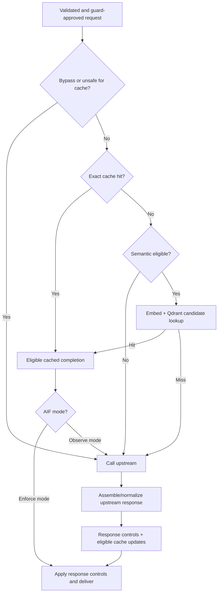

# How AI Cost Firewall Works

AI Cost Firewall (AIF) is a **self-hosted, OpenAI-compatible control point for production AI**. In
**Observe mode**, it identifies potential exact and semantic cache reuse on real traffic; in **Enforce
mode**, eligible cached responses can avoid upstream model calls. This guide explains the **request and
cache decision path**. It complements the
[Architecture](architecture.md) overview, the [Configuration Reference](config-reference.md), and the
focused [Evaluation Mode](evaluation-mode.md) and [Controlled Streaming](controlled-streaming.md) guides.

## Processing sequence

A typical successful request is processed as follows:

1. Parse the OpenAI-compatible chat request, validate body/prompt limits, and preserve completion-affecting JSON fields.
2. Run any enabled **Security Guard request scan**, **Privacy Guard scan/anonymization**, and **Usage Guard request policy evaluation**, in that order.
3. Determine whether the request bypasses cache and whether exact and semantic caching are eligible.
4. Check the Redis exact cache; if eligible and necessary, query the Qdrant semantic cache using an embedding from the configured embedding endpoint.
5. In **Enforce mode** (`enforce`), use an eligible cache hit or call the upstream model. In **Observe mode** (`observe`), send the allowed request upstream while recording potential cache reuse in isolated evaluation state.
6. Normalize the completion; run enabled response Security scanning; write eligible cache state (production or isolated evaluation), then restore Privacy placeholders using the current request mapping.
7. Record usage, cost, metrics, and evidence; return JSON or replay the approved completion as SSE. Evidence delivery to optional VCAL Audit is asynchronous.

The ordering is important: Security Guard may block before any model/cache call, and Privacy Guard
placeholder restoration occurs **after** eligible pre-restoration cache storage. Usage Guard is request-side
in the AIF orchestration described by this documentation. See [Structured Content](structured-content.md)
for the limits of content inspection.

## Cache decision summary



The diagram omits request error branches, guard-specific behavior, and evaluation-cache warming to stay
readable. In Observe mode, `D` represents a **potential** cache hit and is never returned to the client.

## Request identity and cache eligibility

### Exact request identity

The Redis exact cache hashes normalized request data with SHA-256. Completion-affecting
OpenAI-compatible request and message extension fields are preserved in the identity: examples include tools, tool choice, tool-call
IDs, `response_format`, reasoning settings, and other accepted extensions. Delivery-only `stream` and
`stream_options` do not split JSON and SSE cache identities.

Illustrative Redis key:

```text
aif:exact:<sha256>
```

An exact hit can avoid embeddings and an upstream chat call in Enforce mode. Exact cache may also serve
eligible structured-content requests; the full JSON content participates in the key. `exact_cache_enabled`,
`exact_cache_store_enabled`, TTL, and `exact_cache_fail_open` control the path. See [Configuration
Reference](config-reference.md).

### Semantic request eligibility

AIF derives semantic text from eligible **plain-string messages** for Qdrant semantic caching. Requests containing non-string message
content, `tools`, or `response_format` bypass semantic lookup and store. This restriction prevents a
similarity result from ignoring completion-critical structured information.

For eligible text requests, AIF requests an embedding and searches Qdrant. A candidate must satisfy the
configured similarity threshold, be unexpired, contain a valid cached payload, and meet the applicable
model/identity/scope requirements. Example:

```text
Query:       Explain Redis briefly
Candidate:   What is Redis used for?
Similarity:  0.94
Threshold:   0.92
Result:      candidate meets the similarity threshold
```

Crossing the threshold is **necessary but not sufficient**: the other eligibility checks still apply.
Similarity thresholds require application-specific tuning, particularly where apparently similar questions
can require different factual answers.

### Embedding vector and retention

The embedding model and Qdrant collection must use the same vector dimension. Verify the actual vector
length returned by the configured endpoint rather than assuming dimensions from a model's name. The
embedding endpoint may be different from the chat endpoint.

Semantic entries include insertion and expiry metadata. Expired entries are excluded from reuse even if
physical collection cleanup has not run. `semantic_cache_retention_seconds` controls retention; cleanup is
an operational task, not a correctness prerequisite. See [Operations](operation.md).

### Per-request bypass

A request carrying the configured truthy cache-bypass header skips **both exact and semantic lookup and
storage**, including isolated Observe-mode evaluation operations:

```http
X-AIF-Cache-Bypass: true
```

`true`, `1`, `yes`, and `on` are accepted by the documented default behavior. This is distinct from
disabling a cache backend globally. Request bypass counts are recorded in `aif_cache_bypass_requests_total`.

## Observe mode vs. Enforce mode

| Decision | Observe mode (`observe`) | Enforce mode (`enforce`) |
|---|---|---|
| Exact hit | Record potential hit; call upstream; skip evaluation semantic lookup | Return eligible Redis response |
| Exact miss, semantic hit | Record potential hit; call upstream; optionally warm evaluation exact cache | Return eligible Qdrant response; optionally warm exact cache |
| Both miss | Call upstream and populate only evaluation caches if eligible | Call upstream and store if eligible |
| Bypass | Call upstream; no evaluation lookup or store | Call upstream; no cache lookup or store |

Observe mode uses an **isolated Redis namespace and Qdrant collection**; evaluation entries are not
automatically promoted into production. It estimates **potential** avoided calls, tokens, and costs without
changing the client response through caching or reducing actual upstream traffic. Enforce mode records actual
cache outcomes with estimated cost avoidance. Evaluation-only dependency failures do not disrupt live
inference. See [Evaluation Mode](evaluation-mode.md).

## Privacy and other guard effects on caching

When optional **VCAL Privacy Guard** is active, supported text is inspected before cache lookup. If Privacy Guard provides the
complete effective **tenant and policy scope** (policy ID, version, hash), AIF isolates exact/semantic cache
reuse by that effective identity. If the successful scan lacks complete policy identity, or a Privacy Guard
transport failure is allowed to fail open, cache lookup and store are bypassed for that request.

When anonymization is active, cache storage retains the **placeholder-containing** response, not a restored
response containing the current user's sensitive data. Restoration must use the mapping created for the
**current** request. This protects against cross-request placeholder restoration, but does not replace
application authorization or authenticate incoming users. See [Structured Content](structured-content.md).

**Security Guard** detects supported text-based security risks, **Usage Guard** applies organizational
AI usage policy, and **Privacy Guard** handles supported sensitive text. Structured-content inspection
coverage is module- and adapter-specific. AIF does not fetch or scan referenced documents, file
attachments, or opaque non-text content.

## Upstream and response paths

For a cache miss/bypass (and every allowed Observe-mode request), AIF calls the configured
OpenAI-compatible upstream. Set its **base URL**, not a URL that already ends in
`/v1/chat/completions`. Example compatible base URLs may be `https://api.openai.com`, `http://ollama:11434/v1`, or `http://vllm:8000/v1`, depending on
the provider. See [Provider Compatibility](provider-compatibility.md).

For `stream=false` or omitted `stream`, AIF processes a JSON completion. For `stream=true`, it consumes
provider SSE, assembles the whole response, applies response controls, then generates downstream SSE with
`[DONE]`. A client does **not** receive upstream tokens immediately as generated. Provider failures before
approval do not expose partial content. See [Controlled Streaming](controlled-streaming.md).

Independent cache store switches allow lookup without writing new entries. Responses are normalized before
storage and response processing; unsuccessful or otherwise ineligible flows must not be assumed cacheable.

## Limits, failures, and operational signals

- `max_request_body_bytes` caps the HTTP body; `max_prompt_chars` caps parsed prompt content. Configuration
  validity is checked at startup.
- `exact_cache_fail_open` and `semantic_cache_fail_open` determine whether runtime cache problems skip the
  affected path or fail the request under enforcement. They do not disable static validation.
- `/startupz` and `/readyz` distinguish required dependency initialization from current readiness; consult
  [Operations](operation.md) when designing container probes.
- Metrics distinguish exact/semantic hits, misses, bypasses, costs, latency, guard results, and
  evaluation-only opportunities. See [Metrics and Costs](metrics-and-costs.md).
- Structured evidence contains per-trace decisions and one terminal event. Optional asynchronous
  HTTP delivery to **VCAL Audit** uses a bounded in-memory queue and can lose events on overflow or
  exhausted retries. See [Evidence and
  Audit](audit-integration.md).

## Related guides

[Architecture](architecture.md) · [Configuration Reference](config-reference.md) · [Evaluation
Mode](evaluation-mode.md) · [Structured Content](structured-content.md) ·
[Troubleshooting](troubleshooting.md)
