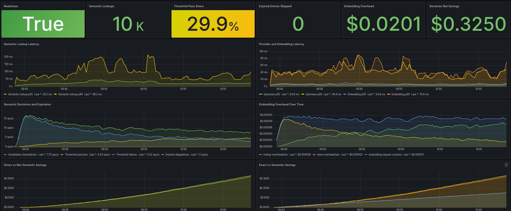

# Metrics, Costs, and Grafana Dashboards

AI Cost Firewall exports Prometheus metrics for actual cache activity, estimated cost savings, and operational diagnostics. **Observe-mode estimates are hypothetical and are kept separate from realized Enforce-mode savings.**

Detailed experimental results and limits belong in [BENCHMARKS.md](../BENCHMARKS.md) and [EVALUATION_VALIDATION.md](../EVALUATION_VALIDATION.md).

## Interpreting costs and savings

AIF measures traffic and estimates monetary values using the configured model and embedding price assumptions. These are estimates, **not provider invoices**. Distinguish:

- **Estimated chat completion cost:** modeled cost based on the relevant request/response token usage and configured model rates.
- **Gross savings:** modeled cost of upstream completions avoided through eligible cache reuse in Enforce Mode.
- **Embedding overhead:** estimated embedding-related spend incurred for semantic cache lookup/store activity.
- **Net savings:** gross savings less the modeled embedding overhead. These values can be negative if semantic lookup overhead exceeds estimated avoided chat spend.
- **Observe Mode opportunities:** hypothetical avoided calls, tokens, and dollars *had* eligible cache decisions been enforced. Live requests still reach the model, so these values must not be added to actual production savings.

A fair assessment requires a stable configuration/pricing basis and a bounded workload. Pair Observe metrics with [Assessment Context](assessment-context.md) and historical `aif_runtime_info`. For experimental parity and limitations, see [Evaluation Validation](../EVALUATION_VALIDATION.md).

## Included Dashboards

AI Cost Firewall includes Grafana dashboards for production cost visibility, cache effectiveness, runtime diagnostics, and high-level guard orchestration health. Evaluation-specific Prometheus metrics are exposed for pilot analysis without being merged into normal production savings counters.

The dashboards are included in the Docker deployment files and are automatically provisioned by Grafana when using the provided Docker Compose setup.

Detailed Privacy Guard, Security Guard, and Usage Guard findings remain in their product-specific dashboards. VCAL Audit provides its own dashboard for ingestion volume, durable persistence latency, authentication failures, hash-chain verification, and license status.

### Cost Savings Overview

<p align="center">
  <a href="../assets/grafana/ai-firewall-overview-021.png">
    
  </a>
</p>

<p align="center">
  <em>30-minute cold-cache demo run with local simulated OpenAI-compatible upstream.</em>
</p>

The Overview dashboard shows the high-level cost and cache impact of AI Cost Firewall.

It demonstrates:

- total request volume
- estimated chat-completion cost
- gross savings from cache reuse
- embedding overhead
- net savings after embedding cost
- net savings percentage
- cache hit rate
- exact and semantic cache activity
- cache bypass request rate
- per-model spend and savings
- savings by cache type
- Usage Guard policy blocks
- high-level guard orchestration health

This dashboard is intended for quick validation, demos, and cost-savings reviews.

---

### Semantic Diagnostics

[](../assets/grafana/ai-firewall-diagnostics-021.png)
<p align="center">
  <em>Semantic diagnostics from the same cold-cache demo run, including readiness, threshold behavior, lookup latency, and cache activity.</em>
</p>

The Diagnostics dashboard provides a deeper operational view of semantic-cache behavior and runtime health.

It demonstrates:

- readiness state
- semantic lookup volume
- semantic threshold pass/fail behavior
- semantic candidate evaluation
- expired semantic entries skipped during lookup
- semantic lookup latency
- upstream and embedding latency
- embedding overhead by operation
- gross vs net semantic savings
- exact vs semantic savings
- semantic cache misses vs threshold passes
- semantic store health
- runtime and provider pressure signals
- provider error classes
- guard orchestration outcomes by guard, stage, and result
- guard orchestration latency
- Usage Guard policy blocks by category
- guard operational signals across Security Guard, Privacy Guard, and Usage Guard

This dashboard is intended for troubleshooting, tuning semantic similarity thresholds, validating fail-open behavior, and understanding runtime cache behavior during pilots.

---

## Metrics Overview

Metrics are exposed at:

```text
http://localhost:8080/metrics
```

Example metrics:

```text
aif_requests_total
aif_cache_exact_hits
aif_cache_semantic_hits
aif_cache_hits_total
aif_cache_bypass_requests_total
aif_model_cost_micro_usd_total
aif_gross_saved_micro_usd_total
aif_net_saved_micro_usd_total
aif_embedding_overhead_micro_usd_total
aif_guard_requests_total
aif_guard_latency_seconds
aif_security_blocks_total
aif_privacy_restore_skipped_total
aif_usage_blocks_total
aif_stream_requests_total
aif_stream_completed_total
aif_stream_errors_total
aif_stream_aborted_total
aif_stream_upstream_errors_total
aif_stream_upstream_chunks_total
aif_stream_upstream_bytes_total
aif_stream_upstream_time_to_first_byte_seconds
aif_stream_generation_duration_seconds
aif_stream_client_time_to_first_byte_seconds
aif_stream_upstream_response_bytes
aif_stream_client_buffer_bytes
aif_stream_duration_seconds
aif_enforcement_mode_info
aif_runtime_info
aif_evaluation_requests_total
aif_evaluation_cache_outcomes_total
aif_evaluation_upstream_calls_avoided_total
aif_evaluation_tokens_avoided_total
aif_evaluation_gross_saved_micro_usd_total
aif_evaluation_net_saved_micro_usd_total
aif_evaluation_shadow_store_total
aif_evaluation_errors_total
```

AI Cost Firewall reports:

- gross chat-completion savings
- embedding overhead
- net savings after embedding cost
- cache hit ratios
- semantic cache diagnostics
- per-model traffic and cost metrics
- guard request counts by guard, stage, and result
- Security Guard block counts by stage and rule ID
- Privacy Guard restore-skip counters when response Security blocks occur
- Usage Guard block counts by policy category and rule ID
- current AIF enforcement mode
- current AIF version/configuration identity through `aif_runtime_info`
- observe-mode exact and semantic cache opportunities
- potentially avoidable upstream calls, tokens, and estimated cost
- shadow-cache store outcomes and evaluation failures

Evidence events are emitted through structured application logs and can optionally be delivered to VCAL Audit. Enable evidence logging with:

```text
RUST_LOG=info,vcal_evidence=info
```


See [Operational behavior](operation.md) for runtime metrics configuration and [Evaluation Mode](evaluation-mode.md) for shadow-cache accounting.
